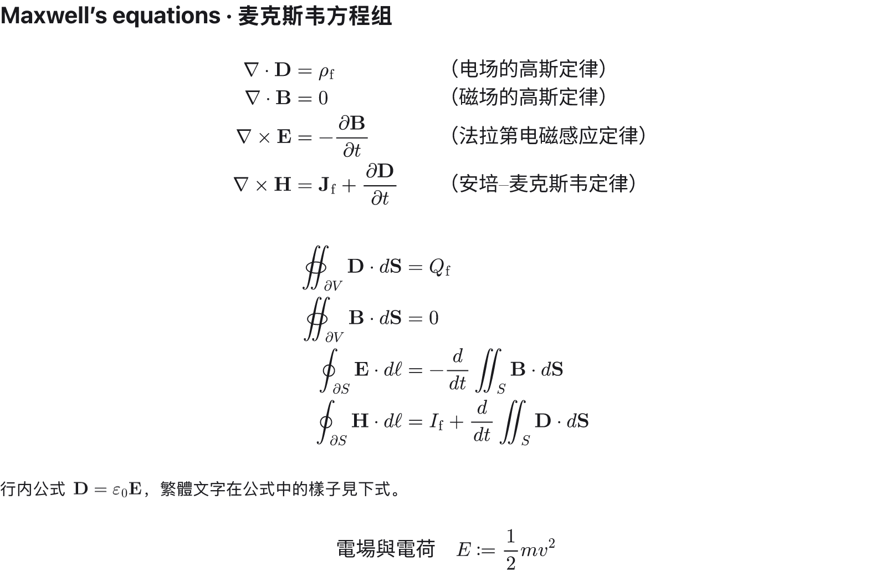

# Math Renderer Plus

[简体中文](README.zh-CN.md) · [Releases](https://github.com/EviterLesRoses2/paseo-math-renderer-plus/releases)

Math Renderer Plus typesets LaTeX in completed Paseo replies. It runs MathJax 4 on the Paseo daemon and sends formula images back to the client. Chinese labels such as `\text{电场强度}` use a bundled font. Formula rendering has been verified on a real iPhone in the native Paseo iOS app. It needs no external service, CDN, or system font.



## Install

Requires Paseo 0.13 or newer, with plugins enabled on the selected daemon. Node.js 22 or later and npm are required on that host to prepare a Git installation.

```sh
paseo plugin install git:EviterLesRoses2/paseo-math-renderer-plus --ref v1.3
paseo plugin ls math-renderer-plus
```

Enable one assistant-message math renderer per host. Running multiple timeline transformers can cause another plugin to take over the same reply.

## Use

Write inline math with `\(...\)` or `$...$`. Use `$$...$$`, `\[...\]`, or a fenced `math` block for display math. Formulas appear once the reply is complete.

Block formulas are centered. On desktop, hover over a formula to reveal **Show LaTeX** and **Copy LaTeX**. On iPhone, tap the formula to show or hide these actions. Long formulas and tables scroll horizontally. Formulas inside Markdown tables render with the rest of the reply. A failed formula preserves the original source and gives the reason. The **Retry** action appears for temporary communication or renderer failures.

The bundled parser supports AMS, AMS CD, boldsymbol, mathtools, cases, cancel, centernot, braket, upgreek, extpfeil, gensymb, textmacros, and physics commands. It covers matrices, aligned equations, common calculus and physics notation, and closed surface and volume integrals. Chinese text uses Noto Sans CJK SC regular. Unavailable characters, custom macro definitions, external links and resources inside formulas, and oversized expressions fall back to source. Large replies can also keep Paseo's original Markdown view.

## Validation

See [the verification record](docs/verification.md) for the desktop test and native-client coverage.

## Development

```sh
npm ci --ignore-scripts --legacy-peer-deps --no-audit --no-fund
npm run prepare:markdown
npm run prepare:wasm
npm run prepare:engine
npm run check
```

Built on [geoqiao/Math Renderer 0.1.0-beta.8](https://github.com/geoqiao/paseo-stuff/tree/math-renderer-v0.1.0-beta.8/plugins/math-renderer). The plugin code is MIT-licensed. See [third-party licenses](THIRD_PARTY.md).
