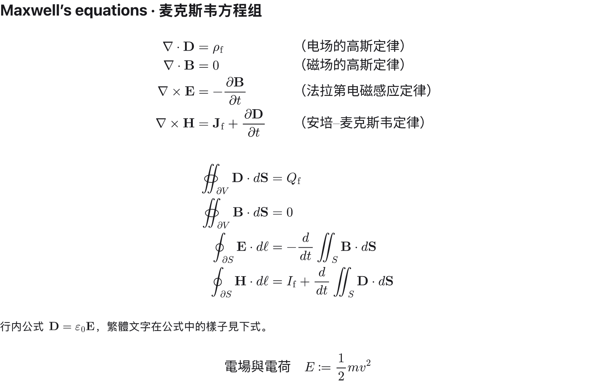

# 公式渲染增强版

[English](README.md) · [发布版本](https://github.com/EviterLesRoses2/paseo-math-renderer-plus/releases)

在 Paseo 会话中渲染助手回复里的 LaTeX 公式。Paseo 主机用 MathJax 4 生成图片，公式里的中文通过随插件提供的字体排版。渲染过程在主机上完成。



## 安装

需要 Paseo 0.13 或更新版本，并在目标主机上启用插件。通过 Git 安装时，主机需要 Node.js 22 或更新版本及 npm。

```sh
paseo plugin install git:EviterLesRoses2/paseo-math-renderer-plus --ref v0.1.1
paseo plugin ls math-renderer-plus
```

同一主机建议只启用一个会改写助手回复的公式插件。

## 使用

行内公式可用 `\(...\)` 或 `$...$`。块级公式可用 `$$...$$`、`\[...\]` 或 `math` 代码块。回复完成后会显示排版结果。

可以查看和复制 LaTeX 源码，较宽的公式和表格可横向滚动，表格单元格里的公式也会排版。支持闭合曲面积分、矩阵、对齐和分段公式、常用微积分命令，以及 `\text{电场强度}` 等公式内中文。遇到未知命令、缺少字形或超限时，会显示原因并保留源码。

[验证记录](docs/verification.md)列出了测试过的客户端和场景。项目基于 [geoqiao 的 Math Renderer](https://github.com/geoqiao/paseo-stuff/tree/math-renderer-v0.1.0-beta.8/plugins/math-renderer)，采用 MIT 许可证。字体等依赖遵循各自的[许可证](THIRD_PARTY.md)。
